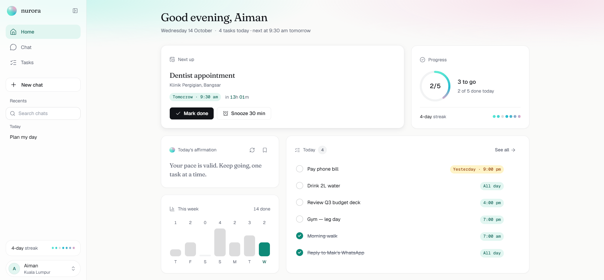
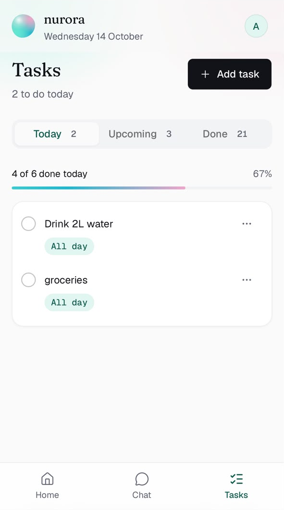
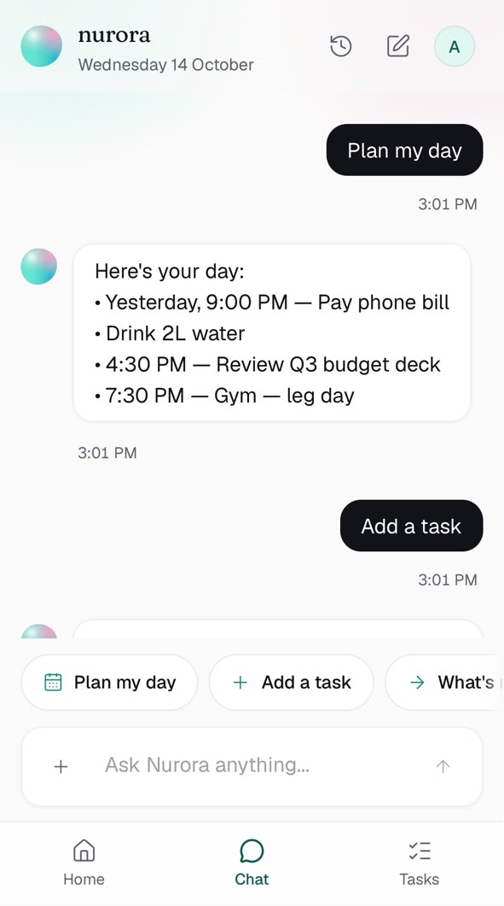
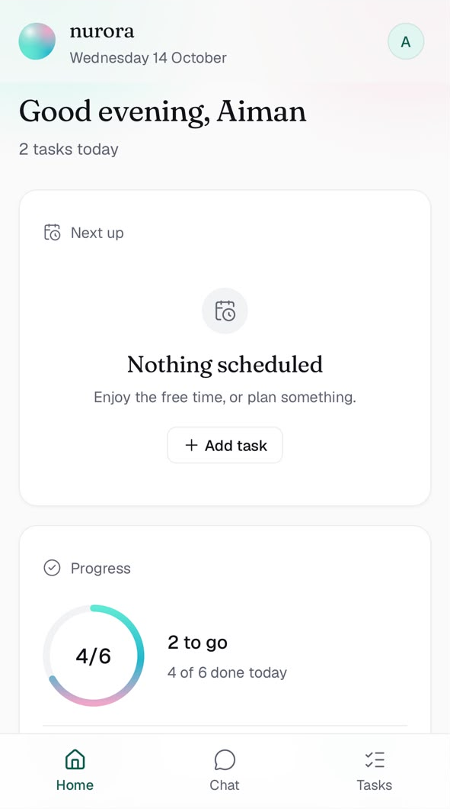
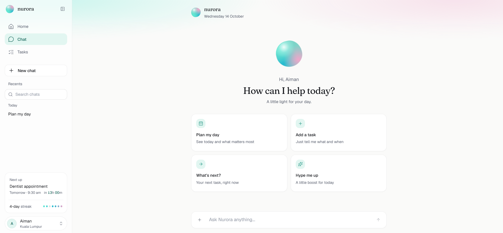
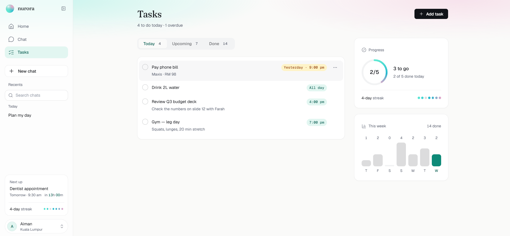
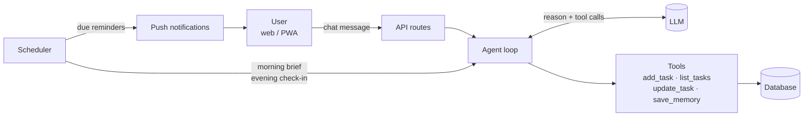

<div align="center">

# nurora

**A little light for your day.**

An AI daily companion that turns casual chat into a plan, reminds you at the right time,<br>
and cheers you on along the way. In English, Malay, or both.

`🚧 In active development`

</div>

---

## Overview

Most to-do apps are forms. Nurora is a conversation.

Type something like *"esok pukul 3 meeting, then malam nak gym"* and Nurora turns it into
scheduled tasks. Each morning it sends a short brief of your day with an affirmation written
for that day, nudges you before things are due, and checks in each evening to roll over
whatever is left. A plain task list works alongside the chat for anyone who prefers buttons.

## Screenshots

<p align="center">
  
</p>

<table>
  <tr>
    <td align="center" width="33%"><br><sub>Home</sub></td>
    <td align="center" width="33%"><br><sub>Chat</sub></td>
    <td align="center" width="33%"><br><sub>Tasks</sub></td>
  </tr>
</table>

<table>
  <tr>
    <td align="center" width="50%"><br><sub>New chat with history</sub></td>
    <td align="center" width="50%"><br><sub>Tasks with progress</sub></td>
  </tr>
</table>

## Features

**Built**

- [x] Responsive interface for phone, tablet and desktop
- [x] Light and dark themes from a single token-based design system
- [x] Home dashboard: next task with live countdown, daily progress, affirmation, today's list, weekly activity
- [x] Task management: add, edit, complete, overdue states, grouped by day
- [x] Multi-conversation chat with history: new chat, auto titles, rename, pin, delete, search
- [x] Accessible components (keyboard focus, WCAG AA contrast, 44px touch targets)

**In progress**

- [ ] Authentication and database (Supabase)
- [ ] AI agent: natural-language task capture with LLM tool calling
- [ ] Long-term memory for personalised briefs and affirmations
- [ ] Reminders, morning brief and evening check-in via push notifications
- [ ] Installable PWA and public deployment

## Tech stack

| Layer | Technology |
|---|---|
| Framework | Next.js (App Router), React, TypeScript |
| Styling | Tailwind CSS, shadcn/ui (Radix), design tokens as CSS variables |
| Typography | Fraunces (display), Geist (UI), Geist Mono (times) |
| Planned backend | Supabase (PostgreSQL + Auth), Next.js route handlers |
| Planned AI | LLM with tool calling behind a provider-agnostic interface |
| Planned delivery | Web Push, PWA, Vercel |

## Architecture

The agent sits on the server. The model never touches the database directly: it can only
request tools, which the server validates and runs for the signed-in user.



**Design principles**

- **AI for language, code for guarantees.** Understanding requests and writing briefs use the
  model; reminders, storage and permissions are plain code.
- **Tools are the only write path,** so every change the agent makes is validated and auditable.
- **Swappable layers.** Storage sits behind a repository module and the model behind a provider
  interface, so the browser store and model can be replaced without touching the UI.

## Project structure

```
app/          routes: home, chat (+ history), tasks; global styles and tokens
components/   layout, home, chat, tasks, shared and ui (shadcn) components
hooks/        reusable React hooks
lib/          data store, conversations, task logic, time helpers, theme
docs/         design system spec
scripts/      developer tooling (multi-viewport screenshots)
```

## Getting started

Requires Node.js 20 or newer.

```bash
npm install
npm run dev
```

Open [http://localhost:3000](http://localhost:3000). To try it on a phone on the same Wi-Fi,
open the `Network:` address printed by `npm run dev`.

| Command | Description |
|---|---|
| `npm run dev` | Start the development server |
| `npm run build` | Create a production build |
| `npm run lint` | Run ESLint |
| `npm run screenshots` | Capture every screen at phone, tablet and desktop widths in both themes (needs the dev server running and Google Chrome installed) |

## Design

The full design system (colour tokens, type scale, spacing, layout rules and component
guidelines) lives in [docs/design.md](docs/design.md). The palette is almost monochrome; the
only colour is a soft aurora gradient used for the orb, progress and the top glow.

---

<sub>© 2026 Sheikh Aiman Hadi. All rights reserved. This repository is shared for portfolio
viewing only. No licence is granted to use, copy, modify or distribute any part of this code.</sub>
